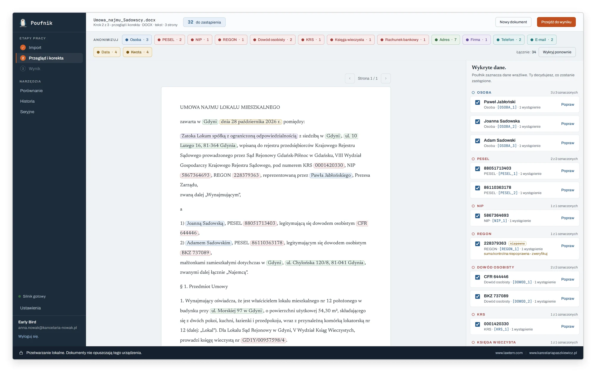
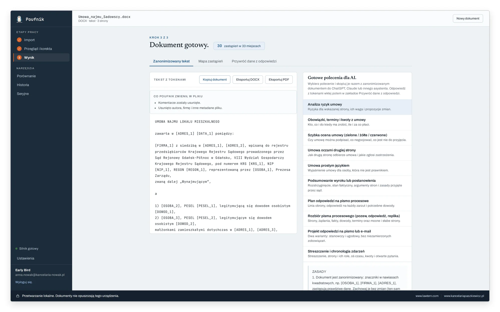

<p align="center">
  
</p>

<h1 align="center">Poufnik – document anonymisation</h1>

<p align="center">
  <strong>A free document anonymisation app for Windows and macOS. It runs locally, on your computer.</strong>
</p>

<p align="center">
  <a href="https://poufnik.app/pobierz/">Download</a> ·
  <a href="https://apps.microsoft.com/detail/9P6ZLK40V3LL">Microsoft Store</a> ·
  <a href="https://apps.apple.com/app/poufnik/id6824860270">Mac App Store</a> ·
  <a href="https://github.com/paszkiewiczmichal/poufnik/releases/latest">Latest release</a> ·
  <a href="README.md">Polski</a>
</p>



Poufnik finds personal data in PDF, Word, Excel files and scans. It replaces the data with tokens or removes it from the file for good before the document goes to an AI chat, a business partner or a public register.

The app is built for Polish. It detects personal, company and court data in more than 20 categories, including inflected surnames, land-register numbers and case references, and replaces them with tokens such as `[OSOBA_1]` or removes them from the file. When an AI model answers the tokenised text, paste the answer into Poufnik and get it back with the real data.

## How it works

1. **Load a document.** PDF, Word, Excel, PowerPoint, OpenDocument (ODT, ODS, ODP), TXT, a scan or a photo of a document (JPG, PNG, HEIC) up to 50 MB, or text from the clipboard. OCR runs on your computer.
2. **Review the detections.** Turn any detection off, move it to another category, or add a missed fragment by hand.
3. **Copy or save the result.** The same person gets the same token throughout the text, so the AI model still knows who is who. Copy the text on its own or together with a ready-made legal prompt, or save a file in the original format.
4. **Restore the data in the AI answer.** Paste the model's answer and the tokens turn back into the real data. The replacement map stays on your computer and is never copied to the clipboard with the text.



## What it detects

Names, including inflected forms, companies and institutions, addresses, PESEL, NIP, REGON, KRS, ID card and passport numbers, bank accounts and payment cards, land-register numbers, case references, vehicle registration and VIN numbers, phone numbers, e-mail addresses and amounts. It can also mask faces on photos and scans (an option in Settings).

## Permanent redaction in PDF

Poufnik removes the characters of the data from the file instead of drawing a box over them, so a name or number cannot be copied from under the redaction. It also cleans the whole file: metadata, comments, attachments, bookmarks and hidden replacement text.

## Document content never leaves the computer

Reading the file, OCR, detection, anonymisation and restoring are done by an engine running on your computer, also offline. The app goes online only to check for updates and to sign in to a Lawtern account, if you use one. These connections never carry document content. The list of connections is in the document [for IT and DPOs](docs/dla-it-i-iod.md) (in Polish).

Poufnik prepares material for safer work; it does not replace legal review. Check the result before you send a document.

## Editions

| Edition | Availability | Includes |
| --- | --- | --- |
| **Basic** | Free, for good, no account | Full anonymisation with no document limit, OCR, export, ready-made prompts |
| **Early Bird** | Free, with a Lawtern account | Everything in Basic, plus new features earlier |

## Install

- **Windows 10 and 11:** [Microsoft Store](https://apps.microsoft.com/detail/9P6ZLK40V3LL) or the `.exe` installer from the [latest release](https://github.com/paszkiewiczmichal/poufnik/releases/latest).
- **macOS 15 or later:** [Mac App Store](https://apps.apple.com/app/poufnik/id6824860270) or a signed DMG from the [latest release](https://github.com/paszkiewiczmichal/poufnik/releases/latest), separate for Apple Silicon and Intel.

## Code

The app's code is public in this repository. The detection engine is not public: the installers include it as a ready-made program that runs locally next to the app and talks to it only over `127.0.0.1`.

| Directory | Contents |
| --- | --- |
| `desktop/` | Tauri 2, React and TypeScript app |
| `desktop/shell-menu/` | Windows Explorer file menu |
| `docs/` | Documentation (IT and DPOs, macOS signing and notarisation, Mac App Store) |

```bash
cd desktop && npm install && npm run test && npm run lint
```

`v*` tags build the Windows (MSIX and `.exe`) and macOS (DMG and Mac App Store) installers in GitHub Actions and publish them on the [releases](../../releases) page.

## Author and licence

Poufnik was built by Michał Paszkiewicz, a Polish attorney (radca prawny), for work in his own [law firm](https://kancelariapaszkiewicz.pl). It is part of the [Lawtern](https://lawtern.com) tools. Contact: contact@lawtern.com, support: support@lawtern.com.

Apache License 2.0, see [LICENSE](LICENSE). Copyright 2026 Kancelaria Radcy Prawnego Michał Paszkiewicz.
