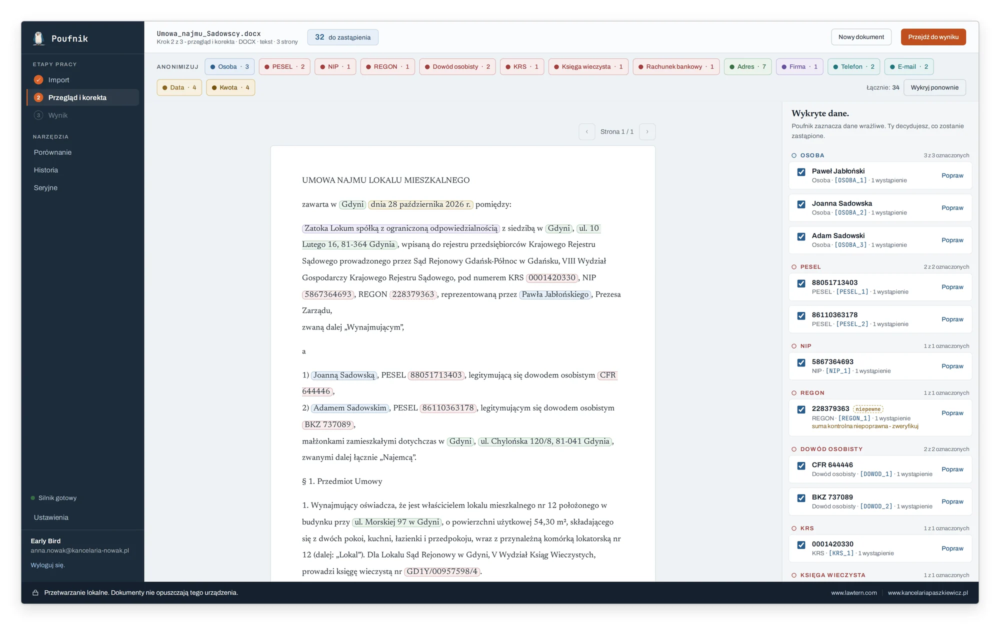
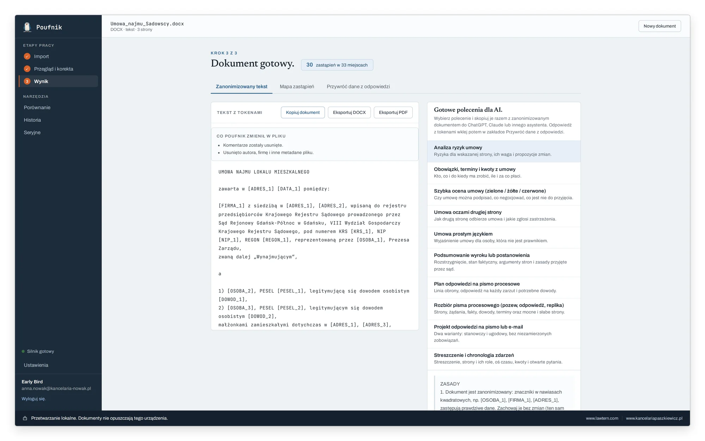
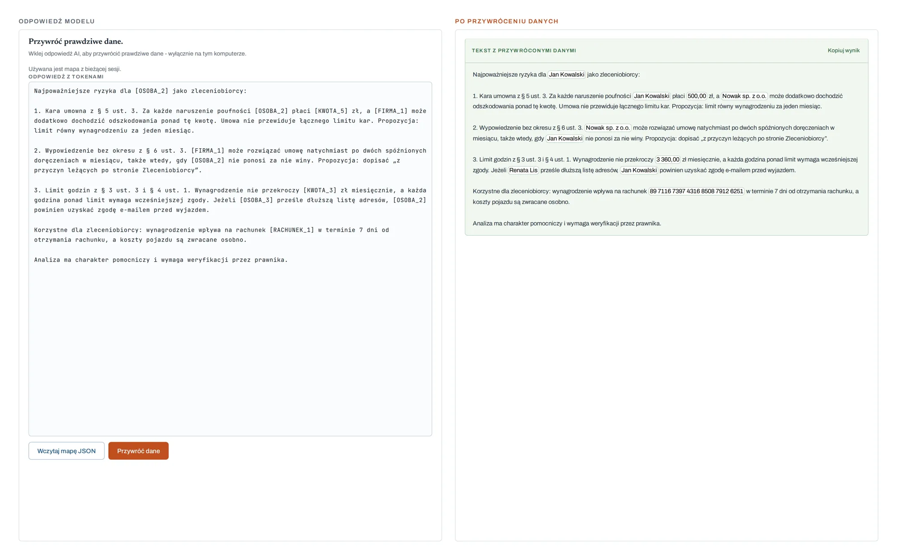
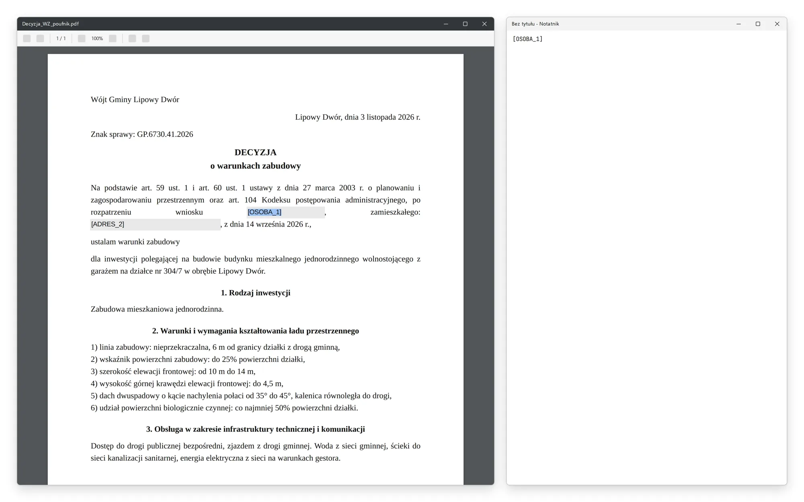

<p align="center">
  
</p>

<h1 align="center">Poufnik – anonimizacja dokumentów</h1>

<p align="center">
  <strong>Darmowy program do anonimizacji dokumentów na Windows i macOS. Działa lokalnie, na Twoim komputerze.</strong>
</p>

<p align="center">
  <a href="https://poufnik.app/pobierz/">Pobierz</a> ·
  <a href="https://apps.microsoft.com/detail/9P6ZLK40V3LL">Microsoft Store</a> ·
  <a href="https://apps.apple.com/app/poufnik/id6824860270">Mac App Store</a> ·
  <a href="https://github.com/paszkiewiczmichal/poufnik/releases/latest">Najnowsze wydanie</a> ·
  <a href="README.en.md">English</a>
</p>



Poufnik znajduje dane osobowe w PDF, Wordzie, Excelu i skanach. Zamienia je na oznaczenia albo trwale usuwa z pliku, zanim dokument trafi do czatu AI, kontrahenta albo do BIP.

Program jest wyspecjalizowany w języku polskim. Wykrywa dane osobowe, firmowe i sądowe w ponad 20 kategoriach, w tym nazwiska w odmianie, numery ksiąg wieczystych i sygnatury akt. Zastępuje je oznaczeniami w rodzaju `[OSOBA_1]` albo trwale usuwa z pliku. Gdy model AI odpowie na tekst z oznaczeniami, wklejasz odpowiedź do Poufnika i dostajesz ją z prawdziwymi danymi.

## Jakie dane wychodzą razem z dokumentem

Plik wysłany do czatu AI, kontrahenta albo opublikowany w BIP niesie więcej danych, niż widać na ekranie.

- Tekst wklejony do czatu AI trafia na serwer dostawcy usługi razem z każdym nazwiskiem, numerem PESEL i sygnaturą.
- Czarny prostokąt w PDF często zasłania tekst tylko na ekranie. Warstwa tekstowa zostaje w pliku i wystarczy ją zaznaczyć i skopiować.
- Plik Worda przechowuje autora, nazwę firmy, komentarze i tekst usunięty w trybie śledzenia zmian.

Poufnik usuwa te dane w jednym przebiegu, a Ty przed zapisaniem widzisz każde wykrycie i decydujesz, co zostaje.

## Jak to działa

1. **Wczytaj dokument.** PDF, Word, Excel, PowerPoint, OpenDocument (ODT, ODS, ODP), TXT, skan albo zdjęcie dokumentu (JPG, PNG, HEIC) do 50 MB, a także tekst ze schowka. Tekst ze skanu odczytuje OCR, który działa na Twoim komputerze.
2. **Przejrzyj wykrycia.** Każde wykrycie możesz wyłączyć albo przenieść do innej kategorii, a fragment, który program pominął, dodać ręcznie.
3. **Skopiuj albo zapisz wynik.** Ta sama osoba ma w całym tekście to samo oznaczenie, więc model AI nadal rozumie, kto jest kim. Tekst kopiujesz sam albo razem z gotowym promptem prawniczym. Plik zapisujesz w tym samym formacie co oryginał.
4. **Przywróć dane w odpowiedzi AI.** Wklej odpowiedź modelu, a oznaczenia zamienią się z powrotem na prawdziwe dane. Mapa zastąpień zostaje na komputerze i nie trafia do schowka razem z tekstem.





## Co wykrywa

Imiona i nazwiska także w odmianie, nazwy firm i instytucji, adresy, PESEL, NIP, REGON, KRS, numery dowodów i paszportów, rachunki bankowe i karty płatnicze, numery ksiąg wieczystych, sygnatury akt, numery rejestracyjne i VIN pojazdów, telefony, adresy e-mail i kwoty. Na zdjęciach i skanach może też zamalować twarze (opcja w Ustawieniach).

## Trwałe zaczernianie w PDF

Poufnik usuwa znaki danych z pliku, zamiast rysować na nich prostokąt, więc nazwiska ani numeru nie da się spod zaczernienia skopiować. Czyści też cały plik: metadane, komentarze, załączniki, zakładki i ukryte teksty zastępcze.



## Treść dokumentu nie opuszcza komputera

Odczyt pliku, OCR, wykrywanie danych, anonimizację i przywracanie wykonuje silnik uruchomiony na Twoim komputerze, także bez internetu. Aplikacja łączy się z siecią przy sprawdzaniu aktualizacji i przy logowaniu do konta Lawtern, jeśli z niego korzystasz. Treści dokumentu w tych połączeniach nie przesyła. Listę połączeń do porównania z kodem zawiera dokument [dla działu IT i IOD](docs/dla-it-i-iod.md).

Model AI dostaje tylko dane potrzebne do zadania, zgodnie z zasadą minimalizacji z RODO. Oznaczenia z mapą zastąpień odwrócisz tylko Ty, na swoim komputerze, i w rozumieniu RODO jest to pseudonimizacja. Trwałe zaczernienie w PDF nie zostawia mapy, więc nie da się go odwrócić.

Poufnik przygotowuje materiał do bezpieczniejszej pracy, ale nie zastępuje przeglądu prawnego. Przed wysłaniem dokumentu przejrzyj wynik.

## Dla kogo

Kancelarie (akta, pisma procesowe, umowy, orzeczenia), urzędy publikujące w BIP, placówki medyczne, działy kadr i księgowości oraz każdy, kto chce pracować z AI na dokumentach bez ujawniania danych osobowych.

## Wersje

| Wersja | Dostępność | Zakres |
| --- | --- | --- |
| **Basic** | Za darmo, na stałe, bez konta | Pełna anonimizacja bez limitu dokumentów, OCR, eksport, gotowe prompty |
| **Early Bird** | Za darmo, z kontem Lawtern | Wszystko z Basic i nowe funkcje wcześniej |

## Instalacja

- **Windows 10 i 11:** [Microsoft Store](https://apps.microsoft.com/detail/9P6ZLK40V3LL) albo instalator `.exe` z [najnowszego wydania](https://github.com/paszkiewiczmichal/poufnik/releases/latest).
- **macOS 15 lub nowszy:** [Mac App Store](https://apps.apple.com/app/poufnik/id6824860270) albo podpisany plik DMG z [najnowszego wydania](https://github.com/paszkiewiczmichal/poufnik/releases/latest), osobno dla Apple Silicon i Intel.

Pierwszy dokument zanonimizujesz bez zakładania konta. Instrukcja krok po kroku jest na stronie [poufnik.app/pobierz](https://poufnik.app/pobierz/).

## Kod

Kod aplikacji jest publiczny w tym repozytorium. Silnik wykrywania nie jest publiczny: instalatory zawierają go jako gotowy program, który działa lokalnie obok aplikacji i łączy się z nią tylko przez `127.0.0.1`.

| Katalog | Zawartość |
| --- | --- |
| `desktop/` | Aplikacja Tauri 2, React i TypeScript |
| `desktop/shell-menu/` | Menu pliku w Eksploratorze Windows |
| `docs/` | Dokumentacja (IT i IOD, podpis i notaryzacja macOS, Mac App Store) |

```bash
cd desktop && npm install && npm run test && npm run lint
```

Tagi `v*` budują w GitHub Actions instalatory Windows (MSIX i `.exe`) oraz macOS (DMG i Mac App Store) i publikują je na stronie [wydań](../../releases).

## Autor i licencja

Poufnika zbudował radca prawny Michał Paszkiewicz do pracy w swojej [kancelarii](https://kancelariapaszkiewicz.pl). Program należy do grupy narzędzi [Lawtern](https://lawtern.com). Kontakt: contact@lawtern.com, wsparcie: support@lawtern.com.

Licencja Apache 2.0, szczegóły w pliku [LICENSE](LICENSE). Copyright 2026 Kancelaria Radcy Prawnego Michał Paszkiewicz.
